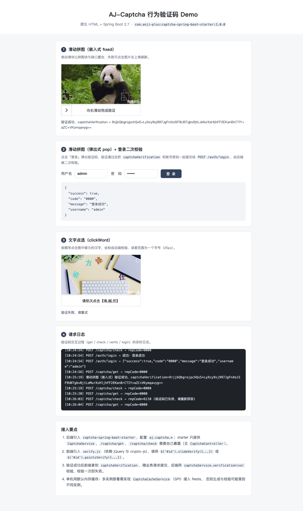

# AJ-Captcha 行为验证码 Demo（原生 HTML + Spring Boot）

一个可以直接跑起来的最小可用示例：后端 Spring Boot 2.7 + `captcha-spring-boot-starter`，前端是原生 HTML 页面（jQuery + 官方 `verify.js` 组件），
包含滑动拼图（嵌入式 / 弹出式）、文字点选，以及登录接口里的**二次校验**。



## 1. 快速开始

```bash
cd aj-captcha-demo
mvn spring-boot:run
```

浏览器打开 <http://localhost:8080>。

打包运行：

```bash
mvn clean package
java -jar target/aj-captcha-demo-1.0.0.jar
```

跑一遍端到端自测（不启动外部服务，测试里会走完整流程）：

```bash
mvn test
```

环境要求：JDK 8+（工程按 Java 8 编译）、Maven 3.6+。依赖 `com.anji-plus:captcha-spring-boot-starter:2.0.0`（Maven 中央仓库）。

## 2. 目录结构

```
aj-captcha-demo/
├── pom.xml
└── src
    ├── main/java/com/example/ajcaptcha
    │   ├── AjCaptchaDemoApplication.java          # 启动类
    │   └── controller
    │       ├── CaptchaController.java             # /captcha/get、/captcha/check、/captcha/verify
    │       └── AuthController.java                # /auth/login：业务接口 + 二次校验
    ├── main/resources
    │   ├── application.yml                        # aj.captcha.* 配置
    │   ├── images
    │   │   ├── jigsaw/original/*.png              # 滑动拼图底图 310×155（20 张）
    │   │   ├── jigsaw/slidingBlock/*.png          # 拼图块 47×155（11 个）
    │   │   └── pic-click/*.png                    # 文字点选底图 310×155（9 张）
    │   └── static
    │       ├── index.html                         # Demo 页面
    │       ├── css/verify.css, css/demo.css       # 组件样式 / 页面样式
    │       ├── js/jquery.min.js, crypto-js.js, ase.js, verify.js   # 官方前端组件及其依赖
    │       ├── fonts/iconfont.*                   # 组件图标字体
    │       └── images/default.jpg                 # 组件加载失败时的占位图
    └── test/java/com/example/ajcaptcha/CaptchaFlowTests.java       # 端到端测试
```

## 3. 接口

jar 包只提供 `CaptchaService`，HTTP 接口需要业务工程自己暴露，路径要与前端组件约定一致。

| 接口 | 说明 | 请求体 | 响应（关键字段） |
| --- | --- | --- | --- |
| `POST /captcha/get` | 获取验证码 | `{"captchaType":"blockPuzzle"}`<br>`clickWord` / `curveSlider` | `repData.originalImageBase64`（底图）、`repData.jigsawImageBase64`（拼图块，点选时为 `wordList`）、`repData.token`、`repData.secretKey` |
| `POST /captcha/check` | 前端拖动/点选后校验坐标，**一次有效** | `{"captchaType":"blockPuzzle","token":"...","pointJson":"AES 加密的坐标","clientUid":"...","ts":169...}` | `repCode=0000` 成功；`6110` 已失效；`6111` 坐标不对 |
| `POST /captcha/verify` | 二次校验（后端） | `{"captchaVerification":"前端 success 回调里的参数"}` | `repCode=0000` 成功，校验通过后该参数立即失效 |
| `POST /auth/login` | 业务接口示例 | `{"username":"admin","password":"123456","captchaVerification":"..."}` | `{"success":true,"code":"0000","message":"登录成功"}` |

错误码（`RepCodeEnum`）：`0000` 成功、`9999` 服务器异常、`0011` 参数为空、`6110` 验证码已失效、`6111` 验证失败、`6112` 获取验证码失败。

## 4. 前后端交互流程

```
浏览器                          后端
  │  POST /captcha/get           │  生成随机缺口坐标，坐标只进服务端缓存（key: RUNNING:CAPTCHA:{token}，2 分钟）
  │ ────────────────────────────>│  返回底图 + 拼图块 + token + secretKey
  │  用户拖动滑块                  │
  │  POST /captcha/check         │  解密 pointJson，与缓存坐标比对（允许误差 aj.captcha.slip-offset 像素）
  │ ────────────────────────────>│  通过 → 缓存二次校验标识（key: RUNNING:CAPTCHA:second-{AES(token---pointJson)}，3 分钟）
  │  前端 success 回调拿到 captchaVerification
  │  POST /auth/login            │  先 captchaService.verification(vo)
  │  （带用户名密码 + 校验参数）    │  校验通过 → 立即失效该参数 → 再走真正的登录逻辑
  │ <────────────────────────────│
```

前端加密方式（`js/ase.js`）：`AES/ECB/PKCS7Padding`，密钥为 `secretKey`，输出 Base64，后端用 `AESUtil`（`AES/ECB/PKCS5Padding`）解密，两者等价。
`aj.captcha.aes-status=false` 时后端不下发 `secretKey`，坐标以明文传输。

## 5. 配置说明（application.yml）

| 配置 | 说明 |
| --- | --- |
| `aj.captcha.type` | `default` 表示同时初始化所有验证码类型，具体用哪种由前端的 `captchaType` 决定 |
| `aj.captcha.jigsaw` | 滑动拼图底图目录，`classpath:images/jigsaw` 表示取 resources 下的目录；约定 `original/*` 与 `slidingBlock/*` |
| `aj.captcha.pic-click` | 文字点选底图目录（`*.png`） |
| `aj.captcha.water-mark` / `water-font` | 底图右下角水印文字与字体，字体用 jar 内置的 `WenQuanZhengHei.ttf` 或系统字体名 |
| `aj.captcha.cache-type` | `local` 内存缓存（单机）；多实例可写 `redis` 并通过 SPI 实现 `CaptchaCacheService` |
| `aj.captcha.slip-offset` | 滑动拼图允许误差（像素），默认 5 |
| `aj.captcha.aes-status` | 坐标是否 AES 加密，默认 true |
| `aj.captcha.interference-options` | 滑动干扰图数量 0/1/2，**310px 宽的底图请保持 0**（见第 7 节） |
| `aj.captcha.req-frequency-limit-enable` | 接口频率限制开关，开启后按 IP+UA 计数并锁定 |

### 底图规格（重要）

前端组件按“底图宽 310px”换算坐标（`js/verify.js` 中 `moveLeftDistance * 310 / imgWidth`），所以：

- 滑动拼图底图建议 **310×155**，拼图块建议 **47×155**（与底图形状一一对应）；
- 文字点选底图建议 **310×155**；
- 页面里 `imgSize` 可以按需放大（坐标会自动换算），但底图本身的像素宽要保持 310 左右，否则用户对齐了图形、后端却收到偏移的坐标。

jar 内置的默认底图是 620×310 的，与官方 H5 组件的换算比例不匹配，因此示例工程自带了 310×155 的底图并由 `aj.captcha.jigsaw` 指定。

## 6. 前端初始化

```html
<!-- 依赖：jQuery、crypto-js（加密坐标）、ase.js（封装函数）、verify.js（组件） -->
$('#mpanel1').slideVerify({
    baseUrl: '',                 // 与页面同源留空；跨域写 http://ip:port
    captchaType: 'blockPuzzle',  // blockPuzzle / clickWord / curveSlider
    mode: 'fixed',               // fixed 嵌入式 / pop 弹出式（pop 必填 containerId）
    imgSize: {width: '310px', height: '155px'},
    barSize: {width: '310px', height: '40px'},
    success: function (params) { /* params.captchaVerification 回传业务接口 */ },
    error: function () {}
});
```

- 文字点选用 `$('#id').pointsVerify({...})`，并设置 `checkNum`（需要点选的文字个数，等于后端 `word-count - 1`，默认 3）。
- 弹出式（`mode: 'pop'`）用 `containerId` 指定点击哪个元素弹出，`beforeCheck` 可在弹出前校验表单。

## 7. 常见问题

**1）`POST /captcha/get` 返回 6112（获取验证码失败）**
服务端日志里通常是 `java.lang.IllegalArgumentException: bound must be positive`，出现在干扰图逻辑里：
`interference-options > 0` 时需要把干扰图插在缺口两侧，底图太窄（310px）时随机范围算成了负数。
解决办法：310px 底图配置 `aj.captcha.interference-options: 0`；要用干扰图就换更宽的底图。

**2）用户明明对齐了缺口，却提示验证失败**
坐标换算比例不匹配，检查底图宽度是否为 310 左右（见第 5 节）；或 `slip-offset` 设得太小。
浏览器控制台/本页“请求日志”里能看到 `/captcha/check` 返回 `6111` 及服务端实际比对结果。

**3）验证码一刷新就提示已失效（6110）**
`get` 生成的坐标只缓存 2 分钟，`check` 校验成功后校验标识保留 3 分钟；超过时间需要重新获取。
接口一次有效也是设计使然：`check` 用完即删，`captchaVerification` 二次校验后也立即失效。

**4）多实例部署后随机失败**
默认 `local` 内存缓存，生成与校验落在不同实例时会互相看不到数据。需要实现 `CaptchaCacheService`（Java SPI，`META-INF/services/com.anji.captcha.service.CaptchaCacheService`）接入 Redis 等集中式缓存。

**5）Linux 上文字水印/点选汉字变成方块**
jar 内置了开源字体 `WenQuanZhengHei.ttf`，默认无需安装系统字体；自定义字体时把 ttf/ttc/otf 放到 resources 的 `fonts/` 目录并配置 `water-font`、`font-type`。

## 8. 验证情况

`mvn test` 会启动完整应用并跑两条端到端用例：

- 滑动拼图：`get` → 读服务端缓存里的真实坐标 → 构造 AES `pointJson` → `check` 通过 → 登录二次校验通过 → 同一 `captchaVerification` 复用返回 `6110`；
- 文字点选：按答案点选通过；故意偏移 100px 时返回 `6111`。

另外在真实浏览器里验证过：嵌入式滑动拼图拖动对齐后提示“验证成功”，弹出式验证码通过后 `/auth/login` 返回登录成功（见上方截图）。
